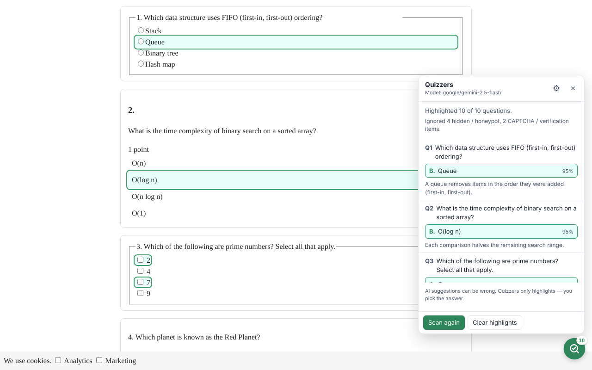

# Quizzers: MCQ Answer Highlighter (Chrome, Manifest V3)

Quizzers finds the **visible** multiple-choice questions on a course page (MIT OpenCourseWare, Coursera, edX and others), sends them to an [OpenRouter](https://openrouter.ai) model, and **highlights** the suggested answer with a light green background (`#e6fffa`) and a green outline (`#38a169`).

For choice questions it only highlights. For short free-text questions it fills in a brief, editable draft answer (you can turn this off). It never clicks, checks, selects or submits anything, so you make the final choice and edit or replace every draft.



## Features

- **Floating trigger.** A small, semi-transparent button sits at the bottom right of course pages. You can drag it up or down, or hide it in the popup. The shortcut is <kbd>Alt</kbd>+<kbd>Shift</kbd>+<kbd>Q</kbd>.
- **Parses many layouts:**
  - native radio and checkbox groups, including visually hidden inputs with custom labels (as on Coursera)
  - ARIA widgets (`role="radio"`, `role="checkbox"`, `role="option"`)
  - `<select>` dropdowns
  - class-named containers (`.question` › `.choice`)
  - lettered options (`A) … B) …`) as lists, paragraphs or `<br>`-separated lines
- **Select-all checkboxes.** The model judges each option independently. The panel says how many to pick ("Select 2 of 4"), and options it is unsure about get a yellow, dashed "maybe" highlight.
- **Short free-text answers.** Visible text, number and textarea fields that read as questions get a brief draft answer that respects `maxlength` and number fields:
  - Only **empty** fields are filled. If you already typed something, it is left alone and the suggestion is shown in a tooltip.
  - Drafts get a green outline and can be edited freely. **Clear highlights** removes drafts you haven't edited.
  - Personal-data fields (name, email, search, address, password forms…) and comment boxes that don't read as questions are never touched.
  - Turn this off with "Fill short free-text answers" in settings to get a highlight-only suggestion instead.
- **Completeness check.** Before parsing, each frame waits (up to 4 s) for the page to stop changing and for loading spinners to disappear, so content that is still rendering isn't missed. After the scan, the panel reports:
  - gaps in question numbering, or a shortfall against "Question N of M" counters (e.g. "The page suggests 14 questions but 1 wasn't found (13)");
  - embedded frames from other sites that couldn't be scanned;
  - pages that were still changing during the scan.
- **No needless API calls.** Answers are cached for the browser session, keyed by model, question and options. Rescanning an unchanged page makes no API call. After more of the page loads, only the new questions are sent. **Clear highlights** also clears the cache, so you can force fresh answers. Up to 150 questions per scan are supported.
- **Readable math.** TeX is recovered from MathJax v2/v3, KaTeX and MathML, and image `alt` text is kept.
- **Iframes.** Questions inside frames (for example edX units) are gathered into the same request.
- **Anti-bot and verification guardrails.** CAPTCHA frames and widgets, bot-challenge pages, honeypot inputs, "leave this blank" prompts and hidden text are detected and never sent to the API (see [Guardrails](#guardrails)).
- **Structured output.** Requests use OpenRouter's `json_schema` structured output in strict mode. If a model or provider doesn't support it, Quizzers falls back to `json_object` and then to a plain prompt.
- **Robust matching.** Answers are matched back by index and by verbatim text. This catches 1-based indices and paraphrased answers.
- **Clear errors** for a missing or invalid key, no credits, rate limits, unknown models, timeouts, truncated replies and inaccessible pages.

## Project layout

```
extension/            ← load this folder in Chrome
  manifest.json       MV3 manifest: permissions, content scripts, popup, shortcut
  background.js       service worker: owns the API key, talks to OpenRouter, coordinates frames
  content.js          content-script entry: collect / highlight / focus / clear, mounts the UI
  content.css         page-level highlight styles
  popup.html/.css/.js API key, model picker, scan scope, "Scan this tab"
  lib/
    config.js         shared constants (models, message types, limits)
    errors.js         typed errors + user-facing messages
    settings.js       chrome.storage.local access
    prompt.js         prompt, JSON schema, reply parsing and answer matching (pure)
    openrouter.js     HTTP client: retries, timeouts, structured-output fallback
  content/
    guards.js         CAPTCHA / challenge / honeypot detection, visibility tests
    text.js           visible-text extraction (skips hidden text, recovers TeX)
    parser.js         MCQ detection strategies
    highlighter.js    visual highlighting (no events, no clicks)
    ui.js             floating button + results panel (closed shadow DOM)
  icons/
tests/                unit, DOM and end-to-end tests, plus HTML fixtures
scripts/              icon generation, Edge build, local fixture server
edge-extension/       generated Microsoft Edge edition (load this folder in Edge)
```

## Load it in Chrome (unpacked)

1. Get the code: `git clone` this repository, or download and unzip it.
2. Open **chrome://extensions** in Chrome 116 or newer. Edge and Brave also work.
3. Turn on **Developer mode** (top-right toggle).
4. Click **Load unpacked** and choose the **`extension/`** folder, not the repository root.
5. Optional: click the puzzle-piece icon in the toolbar and pin **Quizzers**.
6. The settings page opens on first install. Otherwise click the toolbar icon:
   - Paste your OpenRouter API key (`sk-or-v1-…`). Create one at <https://openrouter.ai/keys>.
   - Pick a model. Click **Load all models from OpenRouter** for the live list, or choose **Custom model ID…**.
   - Click **Test key**, then **Save**.

After editing any file, click the **↻ reload** icon on the Quizzers card in chrome://extensions, then refresh the course tab.

> **About model IDs.** `anthropic/claude-3.5-sonnet` and `google/gemini-flash-1.5` are no longer listed on OpenRouter. The presets use current IDs (for example `google/gemini-2.5-flash`, `anthropic/claude-sonnet-5.5`, `anthropic/claude-haiku-5.5`, `openai/gpt-5.4-mini`). Use **Load all models** to see everything that is available right now.

## Microsoft Edge edition

[`edge-extension/`](edge-extension/) is a standalone Edge build that you can load directly. Edge runs the same Chromium Manifest V3 platform, so the code is shared. Only browser-specific wording differs (`edge://` pages, the Edge Add-ons store, `edge://extensions/shortcuts`), along with the manifest name and description.

- **Load it:** open **edge://extensions**, turn on **Developer mode**, click **Load unpacked** and choose `edge-extension/`. [edge-extension/README.md](edge-extension/README.md) has the full steps.
- **Don't edit it directly.** It is generated from `extension/` by `node scripts/build-edge.js`, and a unit test fails if it falls out of sync.
- **Store package:** `npm run package:edge` writes `dist/quizzers-edge-<version>.zip` for Edge Add-ons (Partner Center).
- **Tests:** `npm run test:edge` runs the unit, DOM and end-to-end suites against the Edge build.

## Use it

- **On MIT OCW, Coursera or edX,** click the floating button. Quizzers scans, asks the model and highlights answers. The panel lists each question with the suggested option, a confidence score and short reasoning. Click a question to scroll to it.
- **On any other site,** click the toolbar icon and then **Scan this tab**, or press <kbd>Alt</kbd>+<kbd>Shift</kbd>+<kbd>Q</kbd>. This uses `activeTab` to inject the scripts on demand.
- A **dashed outline** means low confidence (below 50%). Hover a highlighted option to see the reasoning.
- **Clear highlights** removes everything. Highlights are also cleared when a single-page app changes route.
- **Scan scope:** "Whole page" sends every visible question. "Only what's on screen" sends just the questions in the viewport, which is cheaper on long quizzes.

## Test locally

### Manual test with the bundled fixture page

```bash
node scripts/serve-fixtures.js
```

1. Open <http://localhost:8080/quiz.html>. It has 9 questions in different layouts, plus honeypots, a fake reCAPTCHA, a verification prompt, a login form and a cookie banner.
2. Click the Quizzers toolbar icon, then **Scan this tab**. localhost isn't in the default site list, so the popup injects the scripts.
3. Expect 12 answered questions (9 choice questions highlighted, 2 empty text fields drafted, 1 typed answer left unchanged). The panel should also say it ignored 4 hidden/honeypot items and 2 CAPTCHA/verification items.

To test on file:// pages, turn on **Allow access to file URLs** in the extension's details page.

### Automated tests

Requires Node 20+ and Playwright's Chromium (`npm install`, then `npx playwright install chromium` if needed).

```bash
npm test
```

```bash
npm run test:dom
```

```bash
npm run test:e2e
```

- `npm test` runs the unit tests: prompt, schema, reply parsing, answer matching, and the HTTP client's retries, fallbacks and error mapping.
- `npm run test:dom` runs the parser, guards, text extraction and highlighter against real DOM fixtures.
- `npm run test:e2e` loads the unpacked extension in headless Chromium with OpenRouter stubbed. It checks highlighting across frames, that no input is ever checked, payload contents, error flows, challenge pages, on-demand injection and the popup.

The end-to-end suite never calls the real API.

### Debugging tips

- **Service worker logs:** go to chrome://extensions › Quizzers › **service worker** › Console. To see the exact payload, run a scan with the Network tab open.
- **Content script logs:** open the page's DevTools Console and choose the **Quizzers** context in the context dropdown.

## How it works

```
[floating button / popup / shortcut]
        │
        ▼
background.js ── chrome.scripting.executeScript(allFrames) ──► QZ.app.collect() in every frame
        │                                                       (guards → parser → text)
        │◄──────────── questions (text only) ───────────────────┘
        ├── POST https://openrouter.ai/api/v1/chat/completions  (batches of 12, json_schema)
        │◄── {"answers":[{id, correct_indices, correct_texts, confidence, reasoning}]}
        ├── normalizeAnswers(): validate ids/indices, cross-check against option text
        └── executeScript(documentIds) ──► QZ.app.highlight() in the owning frame
                                            (data-qz-highlight attribute + CSS, no events)
```

- **The API key** lives only in `chrome.storage.local` and is used only by the service worker. Content scripts never receive it. The service worker is also the only context that calls OpenRouter, so there are no CORS problems.
- **Highlights target the frame's `documentId`.** If the page navigates mid-scan, stale answers are dropped instead of being painted on the wrong page.
- **Highlighting sets an attribute,** not a class. React and similar frameworks rewrite `className` on re-render but leave unknown attributes alone. Bare text runs use the CSS Custom Highlight API, so no page DOM is modified.

## Guardrails

| Threat | Handling |
| --- | --- |
| CAPTCHA frames (reCAPTCHA, hCaptcha, Cloudflare Turnstile, Arkose, GeeTest, DataDome, PerimeterX…) | Content scripts aren't injected there, and frames on CAPTCHA hosts return nothing even when they are. |
| Full-page challenges ("Just a moment…", `#challenge-form`, CAPTCHA walls) | The whole scan is refused with a message asking you to complete the check yourself. |
| CAPTCHA widgets inside a page (`.g-recaptcha`, `.h-captcha`, `.cf-turnstile`, `[data-sitekey]`…) | Any question whose options sit inside or wrap a widget is skipped. |
| Verification prompts ("I'm not a robot", "Are you human?", "Select all images with…") | Skipped. Bare words like "CAPTCHA" only count when the text isn't phrased as a question, so "What does CAPTCHA stand for?" still works. |
| Honeypot inputs (`*_hp`, `honeypot`, `bot-trap`, Mailchimp `b_…`, `aria-hidden` + `tabindex=-1`) | Skipped. |
| Honeypot prompts ("leave this blank", "if you are human, don't check…") | Skipped. |
| Hidden elements (`display:none`, `visibility:hidden`, opacity ≈ 0, zero-size or clipped, off-screen, `text-indent:-9999px`) | Excluded. |
| Hidden text (same colour as the background, transparent ink, `font-size:0`) | Excluded from stems and options. |
| Prompt injection in page text | The system prompt marks page content as untrusted data, and the reply must match a strict schema. |

## Privacy

Only the question text, the option text and the page title are sent, and only to OpenRouter, using your key. Nothing is stored remotely by the extension. The key never leaves `chrome.storage.local` except in the `Authorization` header to `openrouter.ai`.

## Permissions

- `storage`: settings and the API key.
- `scripting` and `activeTab`: collect and highlight across frames, and inject on demand on sites outside the default list.
- Host permissions:
  - `openrouter.ai` for the API.
  - ocw.mit.edu, openlearninglibrary.mit.edu, mitxonline.mit.edu, coursera.org and edx.org, so the floating button and iframe scanning work there automatically.

## Responsible use

Many courses and platforms forbid AI assistance on graded assessments. Quizzers is meant for practice problems and self-checking. Follow your course's honor code. Model suggestions can be wrong, so treat them as a second opinion, not an answer key.

## Limitations

- Questions rendered as images or canvas, or inside closed shadow roots, can't be read.
- The CSS Custom Highlight API (used for bare text runs) requires Chrome 105+. Native `<select>` popups on macOS ignore option styling, but the dropdown itself is still outlined and its tooltip names the suggestion.
- Site markup changes over time. If a platform stops working, the generic strategies usually still apply. Platform-specific container hints live at the top of `content/parser.js`.
